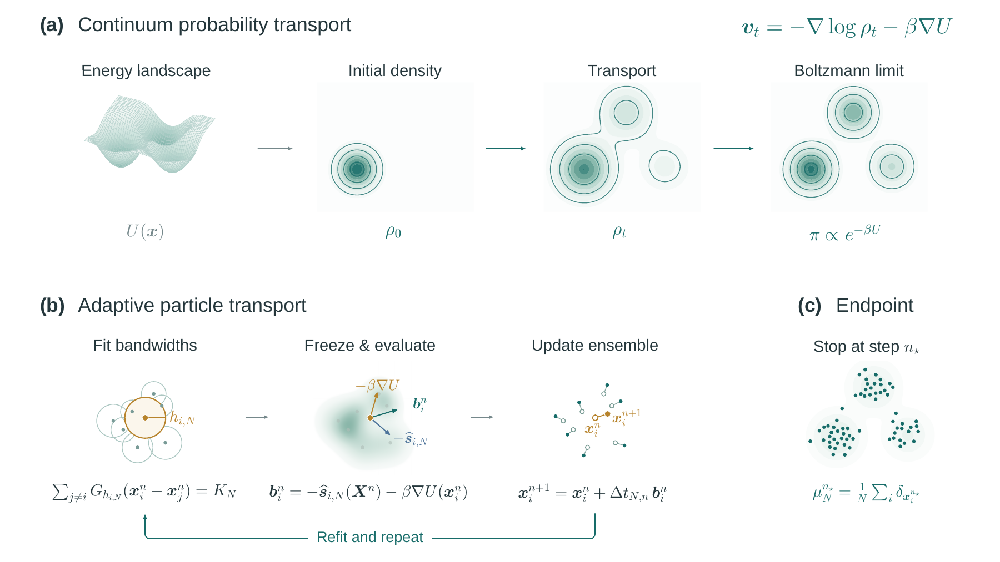

# Fokker–Planck Transformer

Code for **Exploring Boltzmann distributions via kernel-based Fokker–Planck
ensemble transport**, by Xiaoxuan Yu, Zichen Sun, Jun Zhang, and Yi Qin Gao
(2026).



The Fokker–Planck Transformer (FPT) is a training-free, interacting-ensemble
sampler. Instead of waiting for individual trajectories to cross barriers,
it moves all particles together along the probability flow of the
overdamped Fokker–Planck equation,

$$
\boldsymbol v_t(\boldsymbol x) = -\nabla\log\rho_t(\boldsymbol x) - \beta\nabla U(\boldsymbol x),
$$

with the score $\nabla\log\rho_t$ estimated from the current ensemble by a
Gaussian kernel whose per-particle bandwidth is fixed by a prescribed kernel
row mass. The score is an attention readout over the ensemble, and each update
is a residual step. See the paper for the method, its analysis, and the
results.

## Installation

Python 3.11 with JAX (CUDA 12); package versions are pinned in `uv.lock`.

```bash
git clone -b paper https://github.com/xiaoxuan-yu/fp-transformer.git
cd fp-transformer
uv sync --extra cuda --extra examples --extra test
```

## Examples

Each directory under `examples/` holds one study from the paper. Its README
lists the simulation, analysis and plotting commands with the seeds used.

| Example | System | Paper |
|---|---|---|
| [`tb`](examples/tb) | Transport on the two-dimensional Tiwary–Berne landscape | Fig. 2; SI S3.1 |
| [`periodic3d`](examples/periodic3d) | Shared-bandwidth diagnosis on a 3D eight-well periodic landscape | Fig. 3; SI S3.2 |
| [`hidim100d`](examples/hidim100d) | Stable-basin discovery in a 100D periodic landscape | Fig. 4; SI S3.2 |
| [`ala10`](examples/ala10) | Alanine decapeptide with the ECEPP/3 force field | Fig. 5; SI S4.1 |
| [`vina`](examples/vina) | Torsional docking on 190 PoseBusters systems | Fig. 6; SI S4.2–S4.3 |

Commands run from the repository root, e.g.
`uv run python -m examples.tb.run_batch`, and write their outputs under
`data/`.

The library is in `src/fp_transformer`, and its unit tests are in `tests/`.
This branch is the version used for the paper; development continues on
`main`. Each release of this branch is archived at Zenodo.

## Data

Input files are not stored in this repository; they are archived in the
Zenodo dataset [10.5281/zenodo.24341787](https://doi.org/10.5281/zenodo.24341787). Extracted at the repository
root, the archive provides

- `examples/ala10/data`: the ECEPP/3 system and canonical Monte Carlo
  reference for NH2-(Ala)10-COOH, exported from SMMP;
- `examples/vina/data`: the PoseBusters Benchmark journal subset and the
  prepared receptor–ligand pairs (from Zenodo record
  [8278563](https://zenodo.org/records/8278563), CC-BY 4.0; M. Buttenschoen,
  G. M. Morris, and C. M. Deane, *Chem. Sci.* **15**, 3130 (2024)).

The simulation commands in each example README write their outputs under
`data/`, from which the analysis and plotting scripts regenerate all reported
figures and tables. The canonical reference and the Vina inputs can also be regenerated with
`examples.ala10.run_mc_reference` and `examples.vina.download_dataset` /
`examples.vina.prepare_dataset`.

## Citation

```bibtex
@misc{yu2026fpt,
  title  = {Exploring {Boltzmann} distributions via kernel-based
            {Fokker--Planck} ensemble transport},
  author = {Yu, Xiaoxuan and Sun, Zichen and Zhang, Jun and Gao, Yi Qin},
  howpublished = {ChemRxiv},
  doi    = {10.26434/chemrxiv.15012462/v1},
  year   = {2026}
}
```

## License and contact

The code is released under the MIT License (see `LICENSE`); the PoseBusters
data are under CC-BY 4.0. For questions about the code, please open an issue
or contact Xiaoxuan Yu (xiaoxuan_yu@pku.edu.cn).
